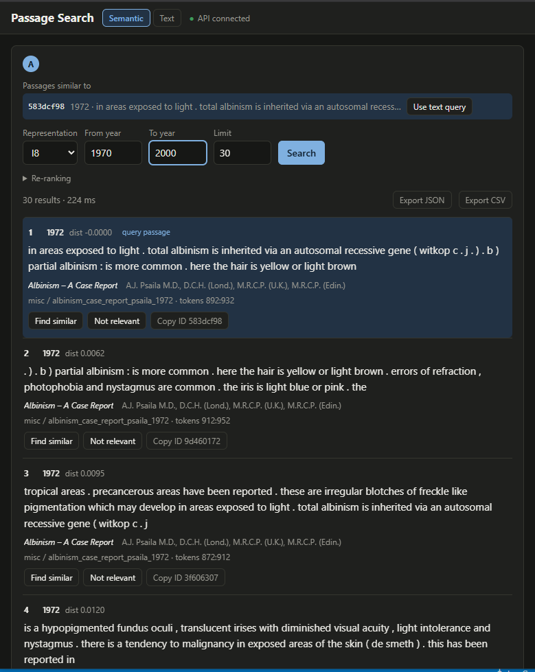
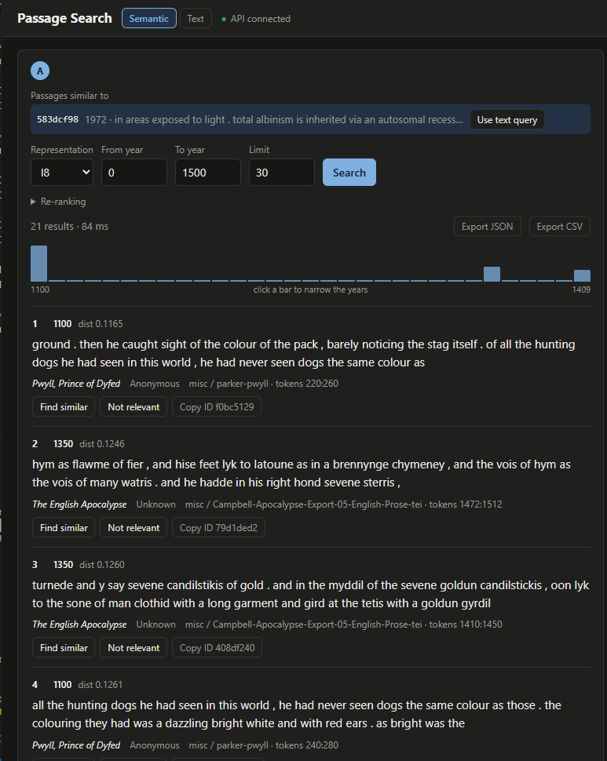
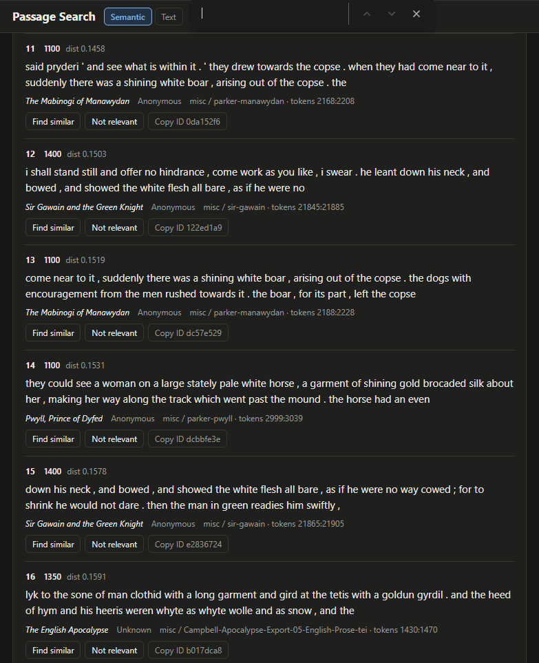

# Passage Search API

From a Postgres database of document metadata and tokens extracted from TEI XML and plain text, 
uses Manjavacas and Fonteyn's historical BERT model [MacBERTh](https://aclanthology.org/2021.nlp4dh-1.4/) 
and Google Colab to create embeddings searched in Lance through a Python FastAPI/SolidJS application.

## Example Use

From an initial search for the term 'albino', find the top result, a 1972 medical text, and select 'find simillar':

Adjust the date range to find historical matches, 0 AD to 1400, and scroll to view references from (translated) Welsh and Judeo-Christian mythology:

## Layout

| File                          | Role                                                                                           |
|-------------------------------|------------------------------------------------------------------------------------------------|
| `core.py`                     | Retrieval primitives: normalise, table selection, stored vectors, search + negative re-ranking |
| `texts.py`                    | Batched Postgres lookup (one query for all hits) |
| `service.py`                  | `PassageSearchService` + `SearchParams`: shared by CLI and API |
| `schemas.py`                  | Pydantic request/response models |
| `api.py`                      | FastAPI app |
| `cli.py`                      | Command-line front end |
| `static/index.html`           | Single-file web UI (SolidJS, no build step), served at `/ui/` |
| `passages_search.py`          | Optional shim so old `ps.search_passages` imports keep working |
| `../lib/macberth-huggingface` | A copy of the MacBERTh model from Hugging Face |

## Run

    uvicorn mutatis_mutandis.api:app --app-dir src --port 8000

Web UI: 

  http://localhost:8000/

Interactive API docs:

   http://localhost:8000/docs

Use one worker: each worker process loads its own copy of the model.

## Examples

    curl -X POST localhost:8000/search -H 'content-type: application/json' \
      -d '{"query": "white hair", "representation": "l8", "limit": 20}'

    curl -X POST localhost:8000/search -H 'content-type: application/json' \
      -d '{"query": "white hair",
           "negative_ids": ["dfbee39870fbbababa5fc24da247fb8468a82350bca1170209458b84568be2c3"],
           "beta": 0.6, "overfetch": 5}'

    # ids only, skip Postgres entirely
    curl -X POST localhost:8000/search -H 'content-type: application/json' \
      -d '{"vector_id": "ef2f4aaf...", "include_text": false}'

## Status codes

200 ok · 404 unknown `vector_id` · 422 invalid request (or ambiguous vector)

Skipped negatives are reported in the `warnings` array of a 200 response.

## Tests

    pytest ./src/mutatis_mutandis/*test*

## Web UI

`static/index.html` is one file: SolidJS is loaded from jsDelivr through a pinned
import map, so there is nothing to build. For offline use, download the four
`solid-js` files named in the import map into `static/vendor/` and point the map
at `/ui/vendor/...`.

URL options: `?panes=2` (up to 6) enables the multi-pane layout and an
"+ Add query" button; `?api=http://host:8000` points the page at another origin
(that server then needs `PASSAGE_SEARCH_CORS_ORIGINS`).

Form state (queries, settings, excluded passages) is kept in `localStorage`;
results are not.

Code layout inside the page: one store holding an array of panes; actions that take
a pane id; components that read their pane by id. Cross-pane features are memos
over the store (see `docIndex` / `overlaps`).
